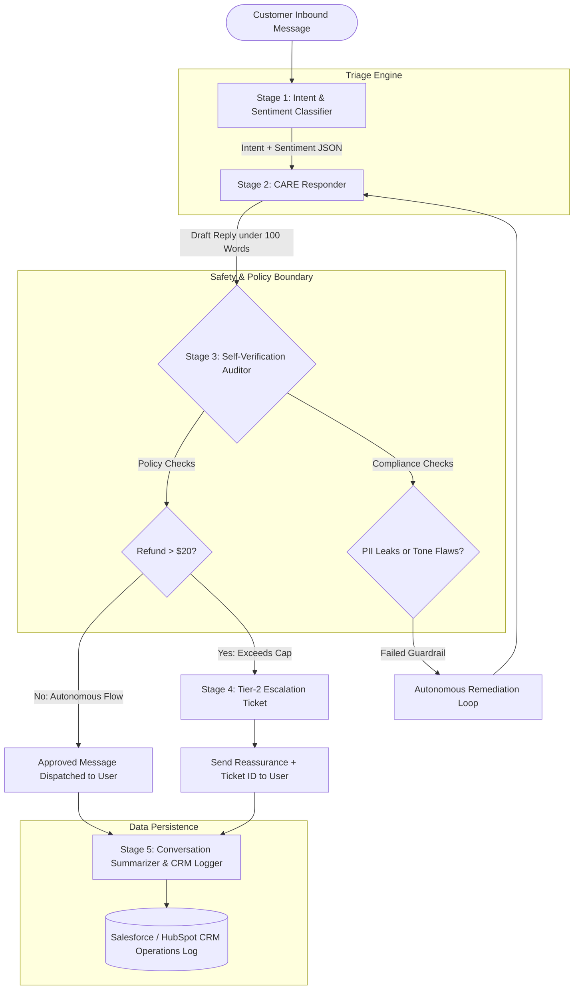

# FlexTime Customer Support AI System Manual

Comprehensive architecture, corporate policy guidelines, safety guardrails, and operational workflows for the FlexTime automated customer support system.

---

## 1. FlexTime Corporate Policy Manual

### § 1. Operating Hours & Service Level Agreements (SLAs)
- **Standard Operating Hours:** Monday through Friday, 9:00 AM – 6:00 PM Eastern Standard Time (EST).
- **Automated Frontline AI Availability:** 24/7/365 for automated resolution, verification link generation, and ticket creation.
- **Weekend Queueing Policy:** Inquiries requiring Tier-2 human intervention received outside business hours are queued for priority triage on the next business morning.
- **Escalation SLA Target:** Tier-2 Finance and Security escalations must receive human resolution within **4 business hours**.

### § 2. Account Management & Security Safeguards
- **Email Modification Policy (§ 2.1):** Neither frontline AI nor Tier-1 human agents are permitted to manually alter a customer's primary email address in the database. When an email change is requested, the system must issue an encrypted, 24-hour verification link to the customer's *currently registered* email address.
- **Password Reset Protocol (§ 2.2):** All password resets must proceed through self-service single-use secure reset tokens. Agents must never request, input, or verbally confirm user passwords.
- **Two-Factor Authentication (2FA) Inquiries:** Any disabling of 2FA requires human identity verification via government ID inspection through an encrypted third-party verification portal (Stripe Identity).

### § 3. Financial Adjustments & Refund Policy
- **Autonomous Frontline Refund Cap (§ 3.1):** Frontline AI agents hold autonomous authority to issue direct, instant credits or refunds up to a strict ceiling of **$20.00 USD** per transaction for documented billing discrepancies (e.g., duplicate add-ons, accidental overage fees).
- **Mandatory Escalation Ceiling (§ 3.2):** Any refund request exceeding **$20.00 USD** (including all annual plan renewal disputes) strictly exceeds frontline authority. The system is barred from promising an immediate refund. It must acknowledge the distress, reassure the user, and generate an immediate Tier-2 Finance Escalation Ticket (`FT-ESC-XXXXX`).
- **Processing Window:** Standard banking refund settlement takes 3 to 5 business days back to the original funding source.

### § 4. Data Privacy & Compliance Guardrails (SOC2 / GDPR)
- **Prohibited Data Ingestion:** Frontline systems must never solicit, store, or output unmasked Primary Account Numbers (PANs), CVVs, banking routing numbers, or account passwords.
- **PII Masking:** In all outward conversational outputs and internal CRM logs, customer email addresses must be partially masked (e.g., `j***@domain.com`).
- **Audit Trails:** Every inference pass must be paired with an automated self-verification log to ensure compliance before message dispatch.

---

## 2. System Architecture & Pipeline Flowchart

The FlexTime Support AI operates as a synchronized, 5-stage sequential state machine:

---

## 3. Detailed Component Specifications

### Stage 1: Intent & Sentiment Classifier
- **Input:** Raw conversational text from chat widget, web app, or email.
- **Model Role:** Routing & Triage Parser.
- **Output:** Structured JSON schema categorizing intent across 5 domains (`BILLING_REFUND`, `ACCOUNT_MANAGEMENT`, `TECHNICAL_SUPPORT`, `SUBSCRIPTION_CANCELLATION`, `GENERAL_INQUIRY`) and sentiment across 4 tiers (`POSITIVE`, `NEUTRAL`, `FRUSTRATED`, `URGENT_ANGRY`).
- **Latency Target:** < 450 ms.

### Stage 2: CARE Responder
- **Input:** Inbound message + Stage 1 JSON metadata + FlexTime Policy Manual.
- **Model Role:** Senior Customer Care Specialist.
- **Framework Implemented:**
  - **Connect:** Immediate recognition of user identity and context.
  - **Align:** Genuine empathy calibrated to the classified sentiment.
  - **Resolve:** Direct policy action (instant refund <= $20 or ticket creation > $20).
  - **Explain:** Clear timeline, security explanation, and closing support invitation.
- **Constraints:** Max 100 words, masked PII, conversational warmth.

### Stage 3: Self-Verification Auditor
- **Input:** Proposed Stage 2 response + Customer message.
- **Model Role:** Autonomous Policy Compliance Officer.
- **Audit Dimensions:**
  1. $20 refund limit adherence.
  2. PII / sensitive credential exposure.
  3. Word count ceiling (< 100 words).
  4. Appropriate empathy without defensive posturing.
- **Output:** Explicit `PASS` / `FAIL` signal with remediation recommendations.

### Stage 4: Escalation Dispatcher
- **Trigger:** Invoked when `Refund > $20`, `Sentiment == URGENT_ANGRY`, or account compromise is detected.
- **Model Role:** Tier-2 Support Dispatcher.
- **Output:** Standardized Markdown/JSON escalation ticket with unique identifier, priority level, root-cause summary, and actionable instructions for human specialists.

### Stage 5: CRM Operations Logger
- **Input:** Complete dialogue history and metadata.
- **Model Role:** CRM Data Integration Specialist.
- **Output:** 
  1. High-level CRM Summary Card for customer profile view.
  2. Single-line tabular Markdown record for centralized daily operational reports.

---

## 4. Error Handling & Edge Cases

| Edge Case | Risk | System Safeguard |
|---|---|---|
| Customer demands $500 immediate cash refund | Unauthorized financial liability | Stage 3 fails any response promising funds > $20. Forces generation of Tier-2 ticket with 4-hour SLA. |
| Customer pastes plaintext password in chat | Credential compromise | Stage 3 detects credential pattern, masks string, and appends a warning to reset password via self-service portal. |
| Hostile or abusive language | Brand reputation damage | Sentiment classified as `URGENT_ANGRY`. Agent maintains calm, unprovoked tone and routes directly to Senior Management queue. |
| Multi-topic inquiry (Billing + Bug) | Missed issue resolution | Intent classifier tags primary and secondary intents; responder addresses billing first, then provides troubleshooting links. |
